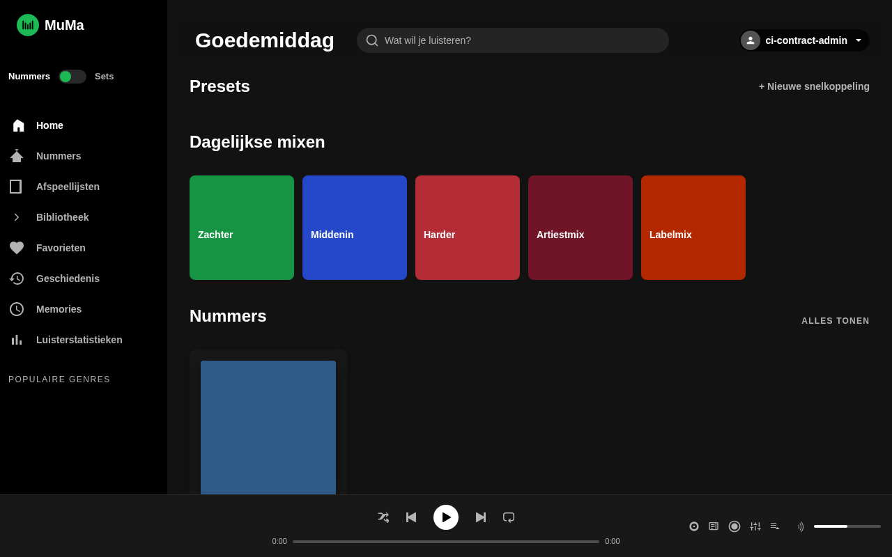

# Music Management (MuMa)

[](LICENSE)

MuMa is a self-hosted music system for a large collection of electronic music. It brings music in,
tags it from rules you set, and plays it on the web, on an Android phone and in the car. Its main
job is one thing a streaming service does not do: build a playlist from a question, such as
"hardstyle from 2009 to 2012, shuffled", every time you ask.

This GitHub repository is a read-only mirror. Development, issues and merge requests happen on the
maintainer's own GitLab, so issues are off here. To report a security problem, see
[SECURITY.md](SECURITY.md).



*The home screen of the web player, as the test suite renders it with one fixture track.*

> **Screenshot to add:** `docs/images/readme/home-desktop.png`. The web player home screen at
> 1280x800 with a full demo library: the "Voor jou" row of feeds, a row of presets and the
> "Recent uitgebracht" shelf. Use a demo account, not a production account.

## Contents

- [Why MuMa exists](#why-muma-exists)
- [Why a standard Subsonic server was not enough](#why-a-standard-subsonic-server-was-not-enough)
- [Sets](#sets)
- [Why the manager exists](#why-the-manager-exists)
- [How music gets in](#how-music-gets-in): importer, downloaders, scanner and tagger rules
- [Other features](#other-features)
- [Getting started](#getting-started)
- [Architecture](#architecture)
- [Repository structure](#repository-structure)
- [Documentation](#documentation)
- [Source code and license](#source-code-and-license)

## Why MuMa exists

I listen to hardstyle, hardcore and uptempo. On Spotify, a playlist for those genres is one of two
kinds. It is "up to date", so it plays the same recent tracks every week. Or it is old, and nobody
updates it.

I want to say "give me hardstyle from 2009 to 2012, in a new order today". Spotify cannot do that.
So I kept my own Spotify playlists per genre and per year: Hardstyle 2009, Hardstyle 2010, up to
Hardstyle 2026, and the same for hardcore and uptempo. I updated all of them by hand. With three
genres and almost twenty years, that got out of hand.

MediaMonkey has dynamic playlists, which are close to what I want. But MediaMonkey runs on a PC on
the local network. It does not play in the car or at work.

So the first goal of MuMa is a dynamic playlist from parameters: genre, year and random order, or
one label. The second goal is control over my own music. The files are mine, the tags are mine, and
no service can remove a track from the collection.

> **Anecdote to add (author):** a short personal story of the moment the hand-made Spotify
> playlists stopped working, or of the first time a MuMa playlist played in the car.

The full product goal, with what MuMa is not, is in [docs/product-goal.md](docs/product-goal.md).

## Why a standard Subsonic server was not enough

A Subsonic server streams your files to any Subsonic app. That part works well. But a standard
server cannot query on genre, year and label together, and it cannot turn that query into a
playlist that stays current.

MuMa builds on two open-source projects and changes them:

- **The server** is a hard fork of [LMS](https://github.com/epoupon/lms) (Lightweight Music
  Server), in `services/music-management-server`. It adds the queries MuMa needs, such as tracks by
  genre, year range, label, festival and track form. [FORK.md](services/music-management-server/FORK.md)
  tells you what changed and why the fork does not follow upstream.
- **The Android app**, MuMa Mobile, started as a fork of [Ultrasonic](https://gitlab.com/ultrasonic/ultrasonic)
  and is now maintained in this repository (`services/muma-mobile`). Since app version 7.0.0 it
  shows the same Svelte interface as the web player. Its native part keeps playback, downloads for
  offline use, Android Auto, voice commands and the widget.

The result is one modern interface on Android, in the car and in the browser. On a PC you use the
web player in a browser. There is no separate desktop app.

The question from the previous section is a **preset** in MuMa. You build it in Advanced search:
pick genres, artists, labels, festivals, a year range, a rating range and the form (songs or sets),
then sort by random, recent, added, starred or name. Save it as a shortcut, and it becomes a tile on
the home screen and an entry under Start > Presets in the car. MuMa looks up the tracks again every
time you play it.

> **Screenshot to add:** `docs/images/readme/preset-builder.png`. Advanced search on desktop with
> genre Hardstyle, years 2009 to 2012 and sort Random, with the result list visible.

> **Screenshot to add:** `docs/images/readme/android-auto-presets.png`. The Android Auto Start tab
> with the Presets list, from the Desktop Head Unit emulator.

## Sets

Because the files are your own, MuMa can tell a song from a set. Every track gets a **form**:

| Form | When |
|---|---|
| `track` | Shorter than 10 minutes |
| `set` | 10 minutes or longer, and no rule below applies |
| `liveset` | A set in the `Livesets/` or `Telegram/` folder, or with a known festival in its title |
| `podcast` | A set that matches a radio show or podcast series you approved |
| `interview`, `preview` | Not music. Music lists leave them out |

The switch "Nummers / Sets" in the web player and the app picks which of the two you browse. A live
set of a known festival edition, for example a set from a festival in 2012, gets the date of that
edition as its performance date. The year filter then files it under 2012, even when the file came
online years later.

The rules are in `services/common/track_form.py`, and the design is in
[docs/designs/track-form/](docs/designs/track-form/functional.md).

> **Screenshot to add:** `docs/images/readme/sets-view.png`. The Sets view on a phone (412x915)
> with live sets from two festivals, so the festival and the date are visible.

## Why the manager exists

A preset is only as good as the tags in the files. To tag a collection of tens of thousands of
tracks by hand is a lot of work. But most of that work follows rules:

- A label usually releases one genre. A release on a hardcore label is hardcore.
- An artist usually makes one genre.
- A subgenre has a parent. Uptempo is hardcore.

The Python services apply rules like these automatically. You set the rules once, on the
Management pages ("Beheer"): which genre a label has, which genre an artist has, which names are
artists and which are not. Every new file then gets its tags from those rules.

The goal is not a perfect library. The goal is a library that is good enough to set up a playlist
quickly. A wrong genre on one track out of a hundred does not spoil a preset.

> **Screenshot to add:** `docs/images/readme/genre-curation.png`. Management > Genre curation
> with the artist-to-genre and label-to-genre tables, with demo data.

## How music gets in

The importer and the downloaders put new files in place and tag them with the rules. The scanner
reads every file into the database, also the files you copied in yourself. After each new file, LMS
gets a scan request, so the track is playable within minutes.

```text
importer, YouTube, SoundCloud, Telegram
        |
        v
tagger rules write the tags into the file
        |
        +--> scanner: tags into the music-manager database (feeds, rules, stats)
        +--> LMS scan: the track is in the player (web, app, car)
```

The tagger finds the type of a file by its folder under the music folder:

| Folder | Type | Example |
|---|---|---|
| `EPs/<label>/<release>/` | Label release | `EPs/Texcore/TEX001 - Release/01.mp3` |
| `EPs/__TODO/` | Import queue, waits for a label | `EPs/__TODO/TEX001 Artist - Release/` |
| `Youtube/<channel>/` | YouTube download | `Youtube/Hysta Official/track.m4a` |
| `Soundcloud/<channel>/` | SoundCloud download | `Soundcloud/Traxtorm/track.mp3` |
| `Telegram/<channel>/` | Telegram download | `Telegram/<channel>/set.mp3` |
| `Livesets`, `Podcasts`, `Top 100`, `Warm Up Mixes` | Sets and mixes | `Livesets/<festival> 2012 - Artist.mp3` |

A file in another folder is scanned but not tagged. [docs/self-hosting.md](docs/self-hosting.md#the-music-folder)
has the same table, with the settings that point to each folder.

### Importer

The importer handles music you bought or got as a label promo. It runs every 5 minutes and does
four steps:

1. **Extract.** It unpacks `.zip` and `.rar` archives into a staging folder and moves only a
   complete extraction into the import queue. An extraction that grows past 50 GB, or leaves less
   than 10 GB free on the disk, stops, and the archive stays in place.
2. **Flatten.** It lifts the releases of a multi-release pack out of their wrapper folder.
3. **Rename.** It puts the catalog number in front of the folder name, from the name or from the
   `.nfo` file of the release.
4. **Move.** It looks up the label of the catalog number (`TEX` is Texcore) and moves the release to
   `EPs/<label>/<release>`. Then it tags every file with the label rules.

Assumptions and limits:

- The importer does not touch a folder that changed in the last 5 minutes, so it leaves a download
  in progress alone.
- A catalog number has letters and digits, at least one digit, and is not a year or a title word
  such as `Anthem`.
- If the catalog number has no known label, the importer reads the `.nfo` (label, catalog number,
  store link) and the Deezer album that the `.nfo` links to. It places the release under the label
  folder they name. If that is not clear, it proposes a label on the Management pages and you pick
  one. It remembers your choice per label.
- The importer deletes a folder with only scene files (`.m3u`, `.nfo`, `.sfv`, a cover) and no
  audio.

Design: [docs/designs/importer/](docs/designs/importer/functional.md) and
[docs/designs/release-info-enrichment/](docs/designs/release-info-enrichment/functional.md).

> **Screenshot to add:** `docs/images/readme/label-proposals.png`. Management > Label proposals
> with one open proposal that has two candidate folders.

### Downloaders: YouTube, SoundCloud and Telegram

Many hardstyle and hardcore tracks come out on the YouTube and SoundCloud channels of labels and
artists before a store has them, or never reach a store. The downloaders follow those channels.

- **YouTube and SoundCloud** use [yt-dlp](https://github.com/yt-dlp/yt-dlp). You add the channels
  on Management > Downloaders. Each worker does a round every 15 minutes. It checks a channel that
  uploaded recently every 6 hours, and a quiet channel less often. Once a month a deep sweep fills
  gaps in the back catalog of a channel. A per-channel archive makes sure MuMa never downloads the
  same item twice.
- **Telegram** downloads files from Telegram channels you take part in, every hour. You set the
  channels in the configuration and log in once with `./run_telegram_auth.sh`.
- The YouTube and SoundCloud logins live in a Firefox container that you open in a browser. When
  YouTube asks for a bot check, log in again there.

What goes into the file, and what MuMa uses it for:

| Tag | Value | Used for |
|---|---|---|
| `TITLE`, `ARTIST` | The upload title, split into artist and title by the rules | Search, artist pages, artist-to-genre rules |
| `ALBUM` | `Youtube (<channel>)` or `Soundcloud (<channel>)` | Groups the uploads of a channel |
| `ALBUM_ARTIST` | The channel | Channel-to-genre rule (YouTube) |
| `PUBLISHER` | `Youtube` or `Soundcloud`, or the label you linked to the channel | Label-to-genre rule |
| `DATE` | The upload date | Year filters, Release Radar |
| Cover | The thumbnail | Cover art |

A curator can link a channel to a label or an artist. A download from that channel then gets the
label as publisher and the artist in place of the channel name
([docs/designs/channel-links/](docs/designs/channel-links/functional.md)).

The downloaders use yt-dlp from PyPI, pinned in `requirements.txt` and updated by Renovate. There is
no separate repository and no yt-dlp fork.

Obey the terms of service of each platform, and download only what you are allowed to.

Design: [docs/designs/downloader/](docs/designs/downloader/functional.md) and
[services/downloader/README.md](services/downloader/README.md).

> **Screenshot to add:** `docs/images/readme/downloaders.png`. Management > Downloaders with the
> channel list and the Timing tab, with public label channels only.

### Scanner

The scanner keeps the database in step with the files. It runs inside music-manager: a full scan
at start-up, then every hour. It walks the whole music folder, reads the tags of each file and
writes them to the library tables.

You need the full scan only for music that did not come through the importer or a downloader, for
example a folder you copied in yourself. MuMa scans files from the importer and the downloaders one
by one as they arrive.

Assumptions and limits:

- The scanner reads tags. It does not change a file. The tagger does that.
- The scanner skips folders that start with a dot, such as `.quarantine`, and Synology `@eaDir`
  folders.
- A tag value longer than its database column is cut, and the file goes into the queue for a new
  tag pass.
- A file that fails three scans in a row, unchanged, waits until it changes.
- A file that is gone from disk loses its database row only when you switch on
  `scanner_drop_vanished_media`. The track and its ratings stay.

Design: [docs/designs/scanner/](docs/designs/scanner/functional.md).

### Tagger rules

The rules are in `services/tagger/Song/rules/`. Each type of file runs its own list of rules, in a
fixed order (`services/tagger/Song/rule_stack.py`). The names below are the class names.

Clean up:

- `CollapseRepeatedValuesRule` repairs titles and artist credits that an old M4A defect repeated.
  It runs first.
- `CleanTitleRule` removes known junk prefixes from the title.
- `CleanTagsRule` splits and cleans the artist, album artist and remixer tags, and removes duplicate
  genres.
- `NormalizeFlacTagsRule` writes FLAC tag names in upper case.
- `ReplaceInvalidUnicodeRule` replaces zero-width characters.
- `DropQueuePlaceholderRule` clears a publisher that is the queue name `__TODO` and not a label.
- `HealStaleCatalogueNumberRule` replaces a catalog number that holds the whole release folder name.

Artists:

- `InferArtistFromTitleRule` splits "Artist - Title" in a download title into artist and title.
- `InferFeatureFromTitleRule` adds "feat." and "ft." artists from the title.
- `InferRemixerFromTitleRule` takes the remixer from "(X Remix)" in the title.
- `ApplyChannelLinkRule` puts in the label and the artist that a curator linked to a channel.
- `CheckArtistRule` writes artist names the way the library spells them, and drops ignored names.
- `AddMissingArtistToDatabaseRule` adds a new artist to the library, for a curator to approve.
- `CaptureDisplayArtistRule` keeps the artist credit as the title wrote it, if it still matches.

Genres:

- `InferGenreFromArtistRule` gives the genre of the artist.
- `InferGenreFromLabelRule` gives the genre of the label.
- `InferGenreFromAlbumArtistRule` gives the genre of the YouTube channel.
- `InferGenreFromSubgenreRule` adds the parent genre: Uptempo adds Hardcore.
- `ResolveGenreRule` lets only approved genres into the file. An unknown genre waits on the Genre
  curation page.

Sets, dates and tempo:

- `InferFestivalFromTitleRule` finds the festival or event, and its date, in the title or the path.
- `InferPodcastFromTitleRule` finds the radio show or podcast and the episode number, for
  recordings of 10 minutes or longer.
- `InferReleaseDateFromNfoRule` gives a label release the best release date it can find: a store
  date, the `.nfo` date, the file date or the arrival date, in that order. It writes the source too.
- `AnalyzeBpmRule` measures the tempo at tag time. It is off by default, because the BPM analyzer
  does this work.

A rule trusts an artist name only when a curator approved it, or when it was in the library before
the curation queue existed. So a wrong guess cannot confirm itself
([docs/designs/artist-curation/](docs/designs/artist-curation/functional.md)).

More: [docs/designs/tagger/](docs/designs/tagger/functional.md),
[docs/designs/genre-curation/](docs/designs/genre-curation/functional.md) and
[docs/designs/release-series-markers/](docs/designs/release-series-markers/functional.md).

## Other features

I added these features because I find them fun or useful. All of them work in the web player and
in the app, because both show the same interface. The Car column tells you which ones Android Auto
has. A dash means the car does not have it, or it does not apply there.

| Feature | What it does | Car | More |
|---|---|---|---|
| Presets | A saved search: genre, year, label, festival, rating, form and sort | Yes | [Android Auto browse](docs/designs/android-auto-browse/functional.md) |
| Memories | Like Google Photos: music released on this day 1, 2 or 10 years ago, one group per year. With no exact match, the same week | - | [design](docs/designs/memories/functional.md) |
| Release Radar | New releases of the last 7 days, matched to your taste | Yes | [feeds](docs/designs/feeds/functional.md) |
| Daily mixes | Three mixes by how hard the music is: softer, middle and harder. Each genre has a hardness from 0 to 100. Each mix is half from the last 12 months and half older | Yes | [feeds](docs/designs/feeds/functional.md) |
| Artist mix and label mix | One artist or one label from your top 10, a new one every day | Yes | [feeds](docs/designs/feeds/functional.md) |
| Old favorites | Forgotten tracks: 4 and 5 star tracks, or tracks you played often, that you did not play in the last half year | Yes | [design](docs/designs/old-hits-feed/functional.md) |
| Five-star ratings | Ratings feed the mixes: 1 and 2 stars stay out of the daily mixes, 4 and 5 stars go into Old favorites. A rating never deletes a file | Yes | [design](docs/designs/ratings-scrobbling/functional.md) |
| Listens | MuMa stores every play from the web, the app or the car in its own database. The server also sends it to ListenBrainz when you set a ListenBrainz token. A play that cannot be delivered waits in a queue | Yes | [design](docs/designs/lms-listen-outbox/functional.md) |
| Listening stats | A personal stats page like stats.fm: what you played, when, how often and from where | - | [design](docs/designs/listening-stats/functional.md) |
| Wrapped (in progress) | A year overview of your listening. The data groundwork is done, and the page is not built yet | - | [design](docs/designs/wrapped/functional.md) |
| Song versions | One song in several versions (radio edit, extended mix, a FLAC and an MP3, a YouTube rip) is one song with a list of versions | - | [design](docs/designs/song-versions/functional.md) |
| Smart deduplication | Every list shows one entry per song: the best version. A play or a rating of any version counts for the song | Yes | [design](docs/designs/song-collapse-in-lists/functional.md) |
| Festival lineups | A list of artists per festival, year or stage. Play it as a warm-up for the festival: it plays your tracks by those artists | Yes | [lineups](docs/festival-lineups.md) |
| BPM | MuMa measures the tempo of every track, newest tracks first, and you can browse by BPM. Confident values go back into the file | Yes | [design](docs/designs/bpm-browse/functional.md) |
| Live radio | Internet radio stations with logos, favorites and search. The device plays the stream of the station directly. A new installation starts with no stations | Yes | [design](docs/designs/live-radio-stations/functional.md) |
| MuMa Radio (beta) | A radio channel made from your own library and a saved filter. Everyone who tunes in hears the same track at the same moment | Yes | [radio mode](docs/radio-mode.md) |
| News | One button plays the latest news bulletin and then goes back to the music. This works well in the Netherlands: MuMa records the NPO Radio 1 news every hour | Yes | [news mode](docs/news-mode.md) |
| Artist images | MuMa downloads artist photos automatically from Spotify, or from Last.fm when Spotify has none | - | |
| Equalizer | A 10-band equalizer with presets, in the browser and in the app | - | |
| Jam mode (in progress) | One device plays, and other devices follow it and control the same queue | - | [notes](services/music-management-server/todo/radio-and-sync-mode.md) |
| Google sign-in | Sign in with a Google account. A new Google account asks an admin for access first | - | [authentication](docs/authentication.md) |

### Song versions and deduplication

A popular hardstyle track can be in a collection five times: the FLAC of the label, a radio edit,
the extended mix, a YouTube rip of the video clip and a SoundCloud premiere. MuMa groups them into
one song. Lists, feeds, search and shuffle show the song once and play the best version. The order
of preference is the file format first (FLAC before MP3, a setting), then the kind of edit. An
official label release comes before a rip. On the page of the song you see all versions, and you can
pin a different one or split a version off.

> **Screenshot to add:** `docs/images/readme/song-versions.png`. The versions page of one song with
> at least three versions (FLAC label release, radio edit, YouTube rip), with the best version
> marked.

### Listening stats and Wrapped

The stats page shows your top artists, tracks, genres and labels, and when you listen. Wrapped will
turn a year of that data into one overview, with a tab for your own listening and a tab for the
whole library: what everyone played, and what MuMa downloaded and tagged that year.

> **Screenshot to add:** `docs/images/readme/listening-stats.png`. Listening stats on desktop for a
> demo account with a few weeks of listens: top artists, top tracks and plays per day.

### More screenshots

> **Screenshot to add:** `docs/images/readme/memories.png`. The Memories page on a phone with groups
> for at least three earlier years.

> **Screenshot to add:** `docs/images/readme/daily-mixes.png`. The Daily mixes page on desktop with
> the Zachter, Middenin and Harder tiles and one mix open.

> **Screenshot to add:** `docs/images/readme/radio.png`. The Radio page on a phone with the station
> logo grid and two favorites.

> **Screenshot to add:** `docs/images/readme/now-playing-phone.png`. Now Playing on a phone with the
> news button and the equalizer button visible.

> **Screenshot to add:** `docs/images/readme/android-auto-start.png`. The Android Auto Start tab
> with the feeds, from the Desktop Head Unit emulator.

> **Screenshot to add:** `docs/images/readme/festival-lineup.png`. A festival lineup on desktop,
> opened at one stage, with the artist list and the "Everything from" play button.

## Getting started

You need a Linux host with Docker and the Compose plugin (`docker compose`), or `docker-compose`
1.28 or later. Your music must be on a disk that the host can reach.

1. Clone the repository.
2. Copy `.env.example` to `.env` and fill in your paths, database credentials and keys.
3. Build the images on the host with `./build.sh --skip-lint --skip-test`.
4. Start the stack with `docker compose -f docker/docker-compose.yml --env-file .env up -d`.
5. Start the player stack in `services/music-management-server` and create the first admin account.

The workers that bring music in (importer, YouTube, SoundCloud, Telegram) are Compose profiles. They
start only when you turn them on, for example with `COMPOSE_PROFILES=importer,youtube` in `.env`.
To start the core services with every worker:

```bash
docker compose -f docker/docker-compose.yml \
  --profile importer --profile soundcloud --profile youtube --profile telegram up -d
```

A one-off command on a worker names its profile too, or Compose says the service does not exist:

```bash
docker compose -f docker/docker-compose.yml --profile importer logs -f importer_worker
```

When the stack is up:

- The web player is on port 80 (`LMS_PORT`), and the Subsonic API on port 8080
  (`LMS_SUBSONIC_PORT`).
- The music-manager API is on port 8000, on the loopback address of the host only. Other machines
  reach it through the nginx of the player at `/muma/api/`.
- phpMyAdmin is on port 8002, on the loopback address of the host only.

[docs/self-hosting.md](docs/self-hosting.md) has every step: the keys, the profiles, the music
folder, the nginx file, Google sign-in, the SoundCloud and YouTube logins, backups, deploys and the
Android app build.

To set or reset a password from the command line:

```bash
./scripts/set_user_password.sh <username>
```

### Event log and alerts

Every service writes its events to the `events` table. You can read them on the Logs page of the
web player and with `GET /api/events`. [ntfy](https://ntfy.sh) can push them to your phone: download
milestones on one topic, warnings and errors on another. `GET /health` returns HTTP 503 when the
database is unreachable or a background loop has stopped, so an uptime monitor can watch it. The
topics and the self-hosted ntfy setting for instant delivery are in
[AGENTS.md](AGENTS.md#-events--alerts).

## Architecture

```text
web player, Android app, Android Auto
        |
      nginx
        |-----------------------------> music-management-server (LMS fork, C++)
        |                                 streaming, Subsonic API, library queries
        |                                 lms.db: an index, rebuilt from the files
        |
        +-- /muma/api ----------------> music-manager (FastAPI, Python)
                                          tagger and scanner, rules, feeds,
                                          ratings, listens, event log
                                          MariaDB: the permanent record

importer and downloaders --> files on disk --> tagger, scanner, LMS scan
```

MariaDB is the permanent record: the library, the rules, ratings, listens and accounts. The LMS
database is an index that LMS can rebuild from the files. Ratings and listens go from LMS to
music-manager, so a rebuilt index loses no rating.

[docs/architecture.md](docs/architecture.md) has the parts, the data ownership and how a track goes
from a download to the player. The table layout is in [docs/database-design.md](docs/database-design.md).

## Repository structure

All apps are in one repository with one history. Each app builds and deploys on its own.

```text
├── services/
│   ├── frontend/                # Svelte web player and Management pages, also shown in the app
│   ├── music_manager/           # FastAPI backend, feeds, ratings, listens, BPM analyzer
│   ├── music-management-server/ # Streaming server and Subsonic API (LMS fork)
│   ├── muma-mobile/             # Android app and Android Auto
│   ├── downloader/              # YouTube, SoundCloud and Telegram workers
│   ├── importer/                # Archive extraction and placement
│   ├── tagger/                  # Rule-based tagging
│   ├── scanner/                 # Library scan
│   ├── ml-analyzer/             # Deprecated, not built
│   └── common/                  # Shared code
├── docs/                        # Designs, bug reports and guides
├── scripts/                     # Build, test and CI scripts
└── tools/                       # One-off maintenance scripts
```

## Documentation

- [Product goal](docs/product-goal.md): what MuMa is for, and what it is not.
- [Architecture](docs/architecture.md): services, data flow and data ownership.
- [Self-hosting](docs/self-hosting.md): install, configure, back up and deploy.
- [AGENTS.md](AGENTS.md): how each part works today, in the most detail.
- [Designs](docs/designs/README.md): a functional and a technical design per feature.
- [API specification](docs/api-specification.md) and [database schema](docs/database-design.md).
- [Style guide](docs/styleguide.md) for the web player and the app.
- [Contributing](CONTRIBUTING.md): local setup, tests, linters and the branch model.
- [Testing inventory](docs/testing-inventory.md): every test suite and how to run it.
- [Security](SECURITY.md): the authentication model and what is scanned.

## Source code and license

MuMa is licensed under the GNU AGPL-3.0 ([LICENSE](LICENSE)), except for two parts that come from
other projects and keep their GPL-3.0 license. `services/music-management-server` is a fork of
[LMS](https://github.com/epoupon/lms) by Emeric Poupon (license text in its `COPYING`).
`services/muma-mobile` derives from [Ultrasonic](https://gitlab.com/ultrasonic/ultrasonic) (license
text in its `LICENSE`). [NOTICE](NOTICE) lists the parts with their copyright lines.

Section 13 of the AGPL says that anyone who uses a modified version over a network can get its
source code. The About screen of the web player and the app (Settings > About) and the login screen
have a **Source code** link for that. The link is the setting `public_source_url` (environment
variable `PUBLIC_SOURCE_URL`, also on Management > Configuration > General). The default is the
placeholder `https://github.com/OWNER/music-management`. If you run your own fork, set it to the
address of your repository, at the revision you deploy. An empty value hides the link.
