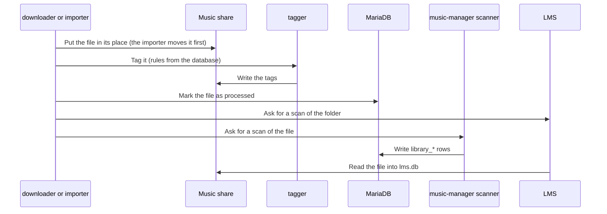

# Architecture

How the parts of the system fit together: what each service does, how a track travels from a
download to the player, and which component owns which data. For why the boundaries sit where they
do, read [product-goal.md](product-goal.md). For the table layout, read
[database-design.md](database-design.md).

## The parts

The system has three groups of components.

| Group | Component | What it does |
| --- | --- | --- |
| Management | `music-manager` | One FastAPI service (port 8000). It handles login, ratings, listens, statistics, curation, the event log and the dashboard API. It also runs background threads: the tagger and scanner loops, the radio scheduler, the news recorder, a sync of users with LMS, the event retention, the listen rematch, the LMS listen backfill, the song-version grouping, the artist auto-approval and the popular-tracks worker. |
| Management | Source workers | `downloader` (YouTube, SoundCloud, Telegram) and `importer` run as separate containers. Each source worker is a compose profile you switch on or off. |
| Management | One-shot jobs | `soundcloud-fetcher` and `genre-processor` run on demand (`run --rm`), not as daemons. |
| Management | `firefox` | A browser you reach through noVNC. It holds the logged-in cookie profile that the downloaders read through `yt-dlp`. |
| Management | `bpm-analyzer` | A container that measures the tempo of every track and stores it in the database. |
| Management | `ml-analyzer` | Deprecated and not deployed. Its code and tables stay. See `services/ml-analyzer/DEPRECATED.md`. |
| Data | MariaDB (`db`) | The permanent record, described under data ownership. |
| Data | phpMyAdmin | A database browser for admins. |
| Playback | Nginx (`lms-reverse-proxy`) | The reverse proxy in front of LMS and `music-manager`. It routes each request to one of them. |
| Playback | `lms-autoheal` | Restarts an LMS container that its health check marks unhealthy. |
| Playback | `music-management-server` (LMS) | A hard fork of the Lightweight Music Server (C++, SQLite). It indexes the files, streams audio, serves the Subsonic API and hosts the web player. |
| Clients | Web player | A Svelte app in `services/frontend`, served with LMS. |
| Clients | `muma-mobile` | The Android app. It talks to LMS over Subsonic and to `music-manager` over HTTP. |
| Clients | APK hoster | A separate service, outside this repository, that hosts the app's APK so updates skip an app store. |

All services live in one repository and one Git history. They build and deploy on their own, and
they talk to each other only over HTTP, Subsonic and shared databases. Everything runs in Docker,
behind a reverse proxy.

## Data ownership

Two databases hold different kinds of data.

**MariaDB (`music_management`) is the permanent record.** `music-manager`, the workers and the
analyzer write to it. It holds:

- the library: `library_tracks`, `library_media_files`, `library_artists`, labels, BPM and the other
  track attributes. Every track has a stable `track_uid`.
- the tagging rules: `rules_*` tables for genres, artists, labels, festivals and podcasts.
- the download history: `downloads_youtube_archive` and `downloads_soundcloud_archive` stop a
  second download of the same item.
- the listening history: `scrobble_listens`, plus `scrobble_unmatched_listens` for plays that match
  no track yet, and `scrobble_imports` for ListenBrainz imports.
- the ratings: `rating_tracks`, keyed on `track_uid`, so moving a file never loses a rating.
- accounts and settings: `users`, `user_app_settings` (a JSON backup of each client's settings),
  `dynamic_playlists` (the definitions only, not the tracks) and the `events` log.

**LMS (`lms.db`, SQLite) is a disposable index.** It holds what the player needs to browse and
play: tracks, artists, releases, play queues, stars, ratings and its own copy of every listen. If
you delete it, LMS rebuilds the index from the files. `music-manager` also writes a few of its own
columns into it (song versions, track form, release dates), and reads it for the user list.

Ratings and listens flow one way, from LMS to `music-manager`. Nothing pushes a rating back to LMS.
If you wipe `lms.db`, the player loses its stars while `music-manager` keeps every one of them.
That is the intended trade, described in [product-goal.md](product-goal.md).

A write that spans several statements runs inside `database.transaction(conn)`. The connection pool
uses autocommit, so `conn.commit()` after several statements commits nothing extra. See
[the transactions design](designs/db-transactions/technical.md).

## How a track gets in

1. A downloader fetches a track (`yt-dlp` for YouTube and SoundCloud, a Telegram client for
   Telegram), tags it and announces it. The importer takes a different route, in steps 4 and 5.
2. The tagger applies the rules in `services/tagger/Song/rules/`. It picks a song type from the
   file's location (`SoundcloudSong`, `YoutubeSong`, `LabelSong` and others), normalizes artists,
   maps genres, extracts remixers and fills the publisher, album and release date. It writes the
   tags into the file.
3. After tagging, the downloader calls `announce` (`services/tagger/announce.py`). It records the
   file as processed, asks LMS to scan the folder and asks the `music-manager` scanner to scan the
   file. Each step is best effort. A slow server never fails a download.
4. The importer finds a release in the import queue, unpacks it and works out its label and
   catalogue number from the folder name, the `.nfo` file and store lookups. It then moves the
   release to its place in the label tree and asks LMS to scan the old and the new folder.
5. After the move the importer tags each file of the release as a `LabelSong` and calls `announce`
   for it, so the same three steps run per file at the new path. The importer, not the downloader,
   pushes one notification per release.
6. `music-manager` also tags and scans on its own schedule, so a file that missed a step is caught
   by the next folder walk. The tagger loop walks the library, and the scanner loop reconciles the
   `library_*` tables with the disk. After a full walk the scanner deletes the `library_media_files`
   row of a file that is gone, never the track, when `scanner_drop_vanished_media` is on.
7. The `bpm-analyzer` measures tempo from a 60 s excerpt and stores it. A later step in the tagger
   round writes confident values into the file's BPM tag.

The services write events to the `events` table. A `WARNING` or higher also goes to a push
notification topic, so the log is complete even when the push service is down.

## How a track is played

The web player and the app stream from LMS with the Subsonic API. LMS authenticates them against
`music-manager`, which holds the accounts (`POST /api/auth/login`). The two services keep their
user lists in step, and `music-manager` reads LMS's `users` table for that.

While you listen:

- **Scrobbles.** The player calls the Subsonic `scrobble` method on LMS. LMS records the listen in
  `lms.db`, writes it to a durable outbox and delivers it to `POST /api/scrobble/event` on
  `music-manager`, which stores it in `scrobble_listens`. A listen that matches no track goes to
  `scrobble_unmatched_listens` and is matched again later. If LMS gave up on a listen (outbox full,
  listen too old), a backfill loop in `music-manager` reads it from `lms.db`.
- **Ratings.** The player and the app call the Subsonic `setRating` method on LMS. LMS then sends a
  webhook to `POST /api/rating/lms-event`, and `music-manager` upserts `rating_tracks`. It finds the
  `track_uid` from the file path in the event. A rating of 0 deletes the row.
- **Settings.** The app and the web player back up their settings to
  `/api/users/{id}/settings/{app_id}`, so they survive a reinstall or a new device.

Beyond the player, `music-manager` serves its own API to the dashboard: library browsing, curation
of genres, artists and labels, statistics, the radio schedule and the event log. Nginx sends
`/muma/api/` calls straight to `music-manager`, except an allowlist of paths that LMS owns (admin
calls, artist images, track refresh and `/muma/users/`), and sends everything else to LMS. The list
is in `services/music-management-server/nginx/reverse-proxy.conf`. See
[authentication.md](authentication.md) for the routing and the key types.

## How the services talk

| From | To | How |
| --- | --- | --- |
| Web player, app | LMS | Subsonic API (`/rest/...`) |
| Web player, app | `music-manager` | REST under `/api/...` |
| LMS | `music-manager` | Webhooks for ratings and listens, with the system key |
| Workers | `music-manager` | REST scan request, with the system key |
| Workers | LMS | Scan trigger, with the Subsonic key |
| `music-manager` | LMS | Subsonic calls, and direct reads and writes on `lms.db` through a shared volume |
| All Python services | MariaDB | Direct connection on the internal Docker network |

The API reference is [api-specification.md](api-specification.md). How to run the
stack yourself is in [self-hosting.md](self-hosting.md).
